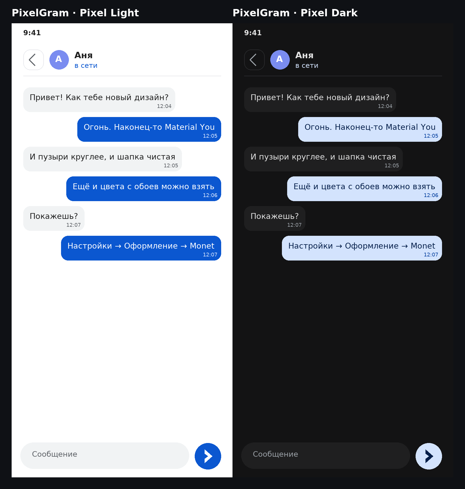

# PixelGram

Неофициальный клиент Telegram для Android: форк [Forkgram](https://github.com/Forkgram/TelegramAndroid)
(а тот — форк официального Telegram for Android). Дизайн — Material You 3 в духе Google Pixel.

> Это не Telegram и не связано с Telegram FZ-LLC. Логотип Telegram не используется.
> Код распространяется по GPL-2.0, как и исходный проект.



<p align="center"></p>

## Что внутри

- палитра Material 3 для светлой и тёмной темы: белые/графитовые поверхности,
  синий акцент, скруглённые пузыри 20 dp;
- динамические цвета Material You (Monet Light / Monet Dark) на Android 12+ —
  тема подстраивается под обои;
- новая иконка и название, свой package id `com.pixelgram.messenger`;
- всё, что было в Forkgram: темы, акцентные цвета, размер шрифта, обои,
  ночной режим, скрытие вкладок, настройки папок и прочее;
- подключение к настоящим серверам Telegram со своим `api_id` / `api_hash`.

## Сборка

Собрать Telegram Android на телефоне нельзя: нужны NDK, ~40 ГБ диска и 8+ ГБ ОЗУ.
Поэтому APK собирает GitHub Actions, а здесь лежит исходник.

1. Создайте на GitHub пустой репозиторий `PixelGram` (public).
2. Загрузите в него эту папку (инструкция ниже).
3. `Settings → Secrets and variables → Actions → New repository secret`:
   - `APP_ID` — число из my.telegram.org;
   - `APP_HASH` — строка оттуда же.
4. Вкладка **Actions** → **Build PixelGram** → **Run workflow**.
5. Через 40–70 минут готовый `PixelGram.apk` появится в **Artifacts**.
6. Установите APK и войдите по номеру телефона.

Если секреты не добавить, сборка пройдёт, но вход в аккаунт не заработает:
`api_id = 0` Telegram не примет.

### Где взять api_id и api_hash

1. Откройте <https://my.telegram.org> и войдите по номеру.
2. **API development tools**.
3. Заполните название (например, `PixelGram`) и короткое имя (`pixelgram`).
4. Скопируйте `api_id` и `api_hash`.

Ключи привязаны к вашему аккаунту и к этому приложению. В публичный репозиторий
их лучше не коммитить — для этого и нужны секреты.

## Установка

APK подписан тестовым ключом из `TMessagesProj/config/test.keystore`.
Для личного использования этого достаточно. Если соберётесь публиковать сборки,
сгенерируйте свой keystore и добавьте его в секреты репозитория.

## Настройка внешнего вида

- **Настройки → Оформление**: темы, акцентный цвет, размер текста, обои,
  ночной режим. Тема по умолчанию — Pixel Light / Pixel Dark.
- **Настройки → PixelGram Settings**: дополнительные возможности форка
  (вкладки, папки, анимации, приватность и т.д.).
- Android 12+: выберите тему **Monet Light** или **Monet Dark**, чтобы цвета
  брались с обоев.

## Сборка на компьютере

Инструкция для Debian 13 и все зависимости — в [BUILDING.md](BUILDING.md).
Кратко:

```bash
git clone --recursive <этот репозиторий>
cd PixelGram
export APP_ID=12345 APP_HASH=ваш_хеш
./gradlew assembleAfatRelease
```

APK: `TMessagesProj_App/build/outputs/apk/afat/release/app.apk`.

## Лицензия и благодарности

- Telegram for Android — Nikolai Kudashov, Telegram FZ-LLC, GPL-2.0.
- Forkgram — сообщество Forkgram, GPL-2.0.
- Monet-темы — Nekogram (через Forkgram).

Исходники PixelGram обязаны оставаться открытыми: это требование GPL-2.0.

## Как загрузить на GitHub

Папка уже готова: внутри лежит git-репозиторий с одним коммитом на ветке `main`
(сам Forkgram подключён отдельным remote `upstream`, чтобы потом можно было брать
его обновления). Остаётся создать пустой репозиторий `PixelGram` (public) и выполнить:

```bash
cd /storage/emulated/0/PixelGram
git remote add origin https://github.com/ВАШ_ЛОГИН/PixelGram.git
git push -u origin main
```

GitHub попросит логин и пароль: вместо пароля вставьте
**Personal Access Token** с правами `repo` и `workflow`
(GitHub → Settings → Developer settings → Tokens (classic)).
После загрузки токен можно отозвать.

Если папку скопировали без `.git`, создайте историю заново:

```bash
cd PixelGram
git init -b main
git add .
git commit -m "PixelGram"
git remote add origin https://github.com/ВАШ_ЛОГИН/PixelGram.git
git push -u origin main
```

После загрузки сборка запускается сама на каждый push в `main`.
Первая сборка идёт дольше обычного: собираются нативные библиотеки
и Rust-часть, обычно 40–70 минут.

## Что дальше можно добавить

- свой набор акцентов вместо стандартных;
- выбор шрифта и плотности списка чатов;
- полностью плоские обои без узора;
- набор иконок приложения;
- отдельный экран «PixelGram» со всеми настройками внешнего вида.
